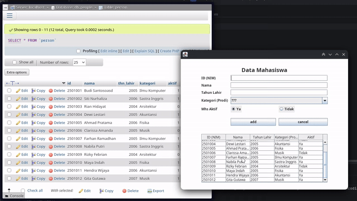

Saya Muhammad Rusydi Akramallah dengan NIM 2508255 mengerjakan TP 5 dalam mata kuliah Desain dan Pemrograman Berorientasi Objek untuk keberkahanNya maka saya tidak melakukan kecurangan seperti yang telah dispesifikasikan. Aamiin

---

## Spesifikasi Teknis, Komponen GUI & Database

### 1. Modul Koneksi Database (`Database.java`)
Class `Database` bertanggung jawab mengelola koneksi JDBC ke database MySQL (`db_people`):
* **Koneksi JDBC**: Terhubung ke `jdbc:mysql://localhost:3306/db_people`.
* `selectQuery(String sql)`: Mengeksekusi perintah SQL `SELECT` dan mengembalikan objek `ResultSet`.
* `insertUpdateDeleteQuery(String sql)`: Mengeksekusi perintah manipulasi data SQL (`INSERT`, `UPDATE`, `DELETE`).

### 2. Form & Komponen Interface (`PeopleMenu.java` & `PeopleMenu.form`)
Aplikasi bekerja langsung menghubungkan komponen GUI Swing dengan database MySQL tanpa menyimpan data pada memori lokal (`ArrayList` telah dihapus sepenuhnya):
* `idField`, `namaField`, `tahunField`: Component `JTextField` untuk input ID/NIM, nama, dan tahun lahir.
* `kategoriComboBox`: Component `JComboBox<String>` untuk opsi pilihan Program Studi/Kategori.
* `yaRadioButton`, `tidakRadioButton`: Component `JRadioButton` dalam `ButtonGroup` untuk menentukan status keaktifan mahasiswa (`boolean aktif`).
* `personTable`: Component `JTable` untuk menampilkan record data dari tabel database berbasis `DefaultTableModel`.
* `addUpdateButton`, `deleteButton`, `cancelButton`: Component `JButton` sebagai kontrol manipulasi data.

---

## Penjelasan Alur Kerja & Logika Program

### 1. Inisialisasi & Render Data (Read)
* Pada saat konstruktor `PeopleMenu` dijalankan, koneksi database diinisialisasi melalui objek `Database`.
* Method `setTable()` mengeksekusi query `SELECT * FROM person` melalui `database.selectQuery()`.
* Hasil query (`ResultSet`) diiterasi baris demi baris untuk membentuk model tabel `DefaultTableModel` yang langsung diikatkan ke `personTable`.

### 2. Penambahan Data Baru (Create) & Validasi Error
* Dipicu oleh tombol `addUpdateButton` saat `selectedIndex == -1`.
* **Validasi Kolom Kosong**: Program memeriksa apakah ada field yang belum diisi (`id`, `nama`, `tahun`) atau kategori yang masih berupa opsi default (`"???"`). Jika ada, dialog peringatan dipicu via `JOptionPane.showMessageDialog(..., "Semua kolom input wajib diisi!", "Error Input", JOptionPane.ERROR_MESSAGE)`.
* **Validasi ID Duplikat**: Method `idTaken(id)` mengeksekusi query `SELECT id FROM person WHERE id = '...'`. Jika ID sudah ada di database, program menampilkan dialog error `JOptionPane.showMessageDialog(..., "ID '...' sudah terdaftar dalam database!", "Error ID Duplikat", JOptionPane.ERROR_MESSAGE)`.
* Jika validasi lolos, query `INSERT INTO person VALUES(...)` dijalankan. Tabel di-render ulang via `setTable()` dan form dibersihkan melalui `clearForm()`.

### 3. Pemilihan & Pembaruan Data (Update) & Validasi
* Event `mousePressed` pada `personTable` menyimpan indeks baris yang dipilih, mengambil data dari sel tabel, mengisikannya kembali ke komponen input form, dan menonaktifkan `idField` (`setEnabled(false)`) agar Primary Key tidak dapat diubah.
* Label tombol utama berganti menjadi `"update"` dan `deleteButton` dimunculkan (`setVisible(true)`).
* Saat tombol `"update"` diklik (`selectedIndex != -1`), program kembali melakukan validasi kolom kosong.
* Jika valid, perintah SQL `UPDATE person SET ... WHERE id = '...'` dieksekusi, lalu tabel di-refresh dan form di-reset.

### 4. Penghapusan Data (Delete) dengan Konfirmasi
* Dipicu oleh pemicu `deleteButton`.
* Program menampilkan modal dialog konfirmasi `JOptionPane.showConfirmDialog(..., "Apakah anda yakin ingin menghapus data mahasiswa?", "Konfirmasi Hapus", JOptionPane.YES_NO_OPTION)`.
* Jika pengguna memilih `YES_OPTION`, query SQL `DELETE FROM person WHERE id = '...'` dieksekusi. Selanjutnya data pada tabel diperbarui dan status form di-reset.

### 5. Reset Status Form (Cancel / Clear)
* Method `clearForm()` mengosongkan seluruh `JTextField`, mereset `JComboBox` ke indeks awal, mengatur `yaRadioButton` ke `true`, mengaktifkan kembali `idField` (`setEnabled(true)`), mengembalikan teks tombol ke `"add"`, menyembunyikan `deleteButton`, serta mengembalikan `selectedIndex = -1`.

---

## Dokumentasi Pengujian Fungsi CRUD

